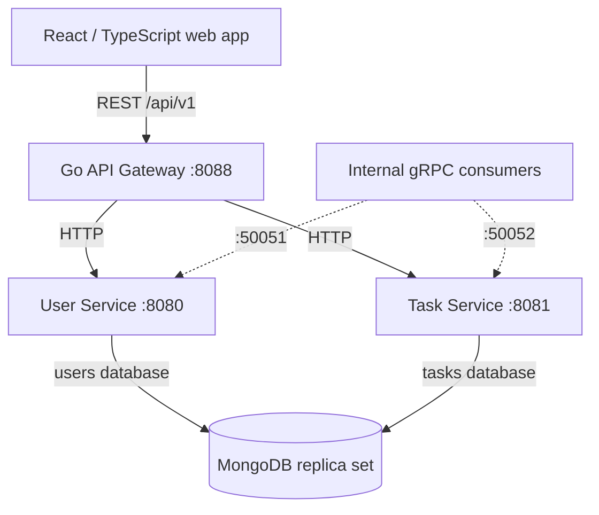

# Task Management

A full-stack, workspace-based task management platform built with React, TypeScript, Go, gRPC, and MongoDB. The application supports collaboration across workspaces and projects, with task tracking, role-based access, and an API-first microservice architecture.

## Overview

Task Management consists of three independently maintained Go backend services and one React web application. Browser traffic reaches the backend through a single API gateway; the user and task services own their respective business logic and persistence. The application is organized as a monorepo containing separate Go modules for each service.

## Features

- **Authentication and accounts:** Registration, login, access-token authentication, rotating refresh sessions, email verification, and password recovery.
- **Workspaces:** Workspace creation and settings, membership management, invitations, ownership transfer, and role-based access.
- **Projects:** Workspace-scoped projects, configurable workflows, visibility controls, and archived project handling.
- **Tasks:** Assignment, priorities, workflow status, due dates, labels, checklists, dependencies, comments, and activity history.
- **Productivity views:** Responsive board and list layouts, search, sorting, filters, saved filters, pagination, and drag-and-drop task ordering.
- **Data consistency:** Idempotency keys, optimistic concurrency using versions, and transactional task/activity writes.
- **Operations:** Health and readiness checks, structured backend diagnostics, metrics, API contracts, automated tests, and security checks.

## Architecture



The gateway implements the browser-facing HTTP API; its upstream communication is HTTP, not gRPC. The user and task services additionally define gRPC interfaces for other consumers. Domain authorization is enforced by the owning services rather than delegated to the frontend.

## Repository structure

```text
Task-Management/
├── .github/workflows/ci.yml   # Continuous integration and security scans
├── docker-compose.yml         # Integrated local backend environment
├── gateway-service/           # Public API gateway and OpenAPI contract
├── user-service/              # Identity, authentication and user data
├── task-service/              # Workspaces, projects and tasks
├── webapp/                    # React single-page application
├── LICENSE
└── README.md
```

| Component | Stack | Role | Documentation |
| --- | --- | --- | --- |
| API Gateway | Go, Fiber | Routing, JWT validation, rate limits, contracts, telemetry | [Gateway README](gateway-service/README.md) |
| User Service | Go, Fiber, gRPC, MongoDB | Accounts, authentication, refresh sessions | [User README](user-service/README.md) |
| Task Service | Go, Fiber, gRPC, MongoDB | Workspaces, projects, memberships, tasks and audit trail | [Task README](task-service/README.md) |
| Web Application | React, TypeScript, Vite, TanStack Query | Browser workflows, state and task views | [Web README](webapp/README.md) |

## Requirements

For the recommended development workflow:

- Docker Engine or Docker Desktop with Docker Compose v2.
- Node.js 22 and npm for the web application.
- Go 1.26.11 (or a compatible toolchain satisfying the `go.mod` directives) for local backend development.
- Make for the documented service quality commands.

The backend databases are provided by Docker Compose. A separate MongoDB installation is not required for the integrated workflow.

## Quick start

### 1. Clone the repository

```bash
git clone https://github.com/Ishan-Gijavanekar/Task-Management.git
cd Task-Management
```

### 2. Start the backend stack

```bash
docker compose up -d --build
```

This starts MongoDB 7.0 as a single-node replica set, the user service, the task service, and the API gateway. Only the gateway is published for normal browser API access. Development defaults are provided in the root `docker-compose.yml`.

### 3. Start the frontend

In a second terminal:

```bash
cd webapp
npm ci
npm run dev
```

Open **http://localhost:5173**. Register or sign in, create a workspace, create a project, and begin managing tasks. The web app remembers only workspaces created or explicitly opened in that browser; the public API does not currently expose a general workspace-list endpoint.

### 4. Stop the stack

```bash
docker compose down
```

MongoDB data remains in the `mongo_data` volume. `docker compose down -v` additionally removes the volume and **deletes local database data**.

## Local endpoints

| Endpoint | Purpose |
| --- | --- |
| `http://localhost:5173` | Web application (Vite) |
| `http://localhost:8088/api/v1` | Public REST API |
| `http://localhost:8088/openapi.json` | Public OpenAPI 3.1 specification |
| `http://localhost:8088/livez` | Gateway liveness |
| `http://localhost:8088/readyz` | Gateway upstream readiness |
| `http://localhost:8088/metrics` | Prometheus-format gateway metrics |
| `localhost:27019` | MongoDB host-published development port |

The user-service HTTP/gRPC ports (`8080`/`50051`) and task-service HTTP/gRPC ports (`8081`/`50052`) are exposed within the Compose network, but not published to the host by the root Compose stack.

## API overview

The versioned public API uses the `/api/v1` prefix. Key route families include:

| Area | Examples |
| --- | --- |
| Authentication | `POST /auth/register`, `/auth/login`, `/auth/refresh`, `/auth/logout` |
| Account recovery | `POST /auth/forgot-password`, `/auth/reset-password`, `/auth/verify-email` |
| Users | `GET /me`, `GET /users`, `GET /users/{id}` |
| Workspaces | `POST /workspaces`, `GET /workspaces/{id}`, `PATCH /workspaces/{id}` |
| Projects | `GET /workspaces/{id}/projects`, `POST /workspaces/{id}/projects` |
| Tasks | `GET /workspaces/{id}/tasks`, `POST /workspaces/{id}/tasks` |
| Collaboration | Workspace members, invitations, task comments and activities |
| Notifications | `GET /notifications`, notification preferences and read actions |

Examples are relative to `/api/v1`. For exact methods, schemas, status codes and supported operations, consult [the canonical OpenAPI specification](gateway-service/api/openapi.json); this table is not an exhaustive endpoint inventory.

Protected routes accept `Authorization: Bearer <access_token>`. Browser refresh sessions use an `HttpOnly` cookie. Do not store production secrets or authentication tokens in source control.

## Configuration

The integrated Docker Compose environment supplies development settings directly. For standalone operation, start with the service-specific examples:

| Component | Configuration | Important variables |
| --- | --- | --- |
| Gateway | [`gateway-service/.env.example`](gateway-service/.env.example) | `PUBLIC_ORIGIN`, `USER_SERVICE_URL`, `TASK_SERVICE_URL`, `JWT_SECRET`, `JWT_ISSUER` |
| User | [`user-service/.env.example`](user-service/.env.example) | `MONGO_URI`, `MONGO_DATABASE`, JWT, refresh-cookie and SMTP options |
| Task | [`task-service/.env.example`](task-service/.env.example) | `MONGO_URI`, `MONGO_DATABASE`, JWT, timeout and concurrency settings |
| Web | [`webapp/README.md`](webapp/README.md) | Optional `VITE_API_URL` pointing to a complete `/api/v1` base |

Keep JWT verification settings consistent across backend services. Replace the sample JWT signing secret before any shared or production deployment. Use an HTTPS origin and secure refresh cookies in production; configure SMTP to deliver verification and password-reset emails. Adjust proxy trust, request-size limits, database connectivity, and telemetry for the deployment environment.

## Development and testing

Each Go service is a separate module. Run Go commands from its own directory.

```bash
cd gateway-service
go vet ./...
go test -race ./...
make contract
make types-check
```

```bash
cd user-service
make quality
make test-race
make coverage-check
```

```bash
cd task-service
go vet ./...
go test -race ./...
```

```bash
cd webapp
npm ci
npm run format:check
npm run lint
npm test
npm run build
npx playwright install chromium
npm run test:e2e
```

Integration tests for the user service require a reachable MongoDB instance and the `MONGO_INTEGRATION_URI` setting. The repository's GitHub Actions workflow also runs formatting, automated tests, browser E2E checks, OpenAPI compatibility checks, frontend type-generation checks, `govulncheck`, Gitleaks, and Trivy image scanning.

## API contracts and consistency

- **Public REST:** [`gateway-service/api/openapi.json`](gateway-service/api/openapi.json) defines the contract; [`gateway-service/docs/api-policy.md`](gateway-service/docs/api-policy.md) describes compatibility and HTTP API conventions.
- **Generated frontend models:** `gateway-service/api/generated.ts` is checked against the public contract using `make types-check`.
- **Internal RPC:** The user and task services maintain Protocol Buffer definitions and generated Go gRPC bindings.
- **Concurrency:** Task updates and other documented mutations use entity versions; stale writes return conflict errors.
- **Idempotency:** Documented write operations support `Idempotency-Key` to guard against duplicate mutation execution.
- **Data integrity:** Task mutations use MongoDB transactions, requiring a replica-set-backed MongoDB instance.
- **Authorization:** Workspace-scoped permissions are described in [`task-service/docs/authorization.md`](task-service/docs/authorization.md).

## Security and operations

Authentication tokens are validated at the gateway and authorization is checked by domain services. Access tokens are short-lived; browser refresh tokens are handled through rotating server-side sessions and `HttpOnly` cookies. Additional safeguards include bounded requests and upstream timeouts, route-specific rate limits, audit records, and dependency/security scanning in CI.

For diagnostics, the gateway exposes liveness, readiness, metrics, and request identifiers. Distributed trace context is propagated upstream and OTLP tracing can be enabled with `OTEL_EXPORTER_OTLP_ENDPOINT`. Do not interpret a successful liveness check as proof that upstream dependencies are ready.

## Additional documentation

- [API Gateway](gateway-service/README.md)
- [User Service](user-service/README.md)
- [Task Service](task-service/README.md)
- [Web Application](webapp/README.md)
- [Public API policy](gateway-service/docs/api-policy.md)
- [Task authorization matrix](task-service/docs/authorization.md)

## License

Licensed under the [MIT License](LICENSE). Copyright (c) 2026 Ishan Gijavanekar.
