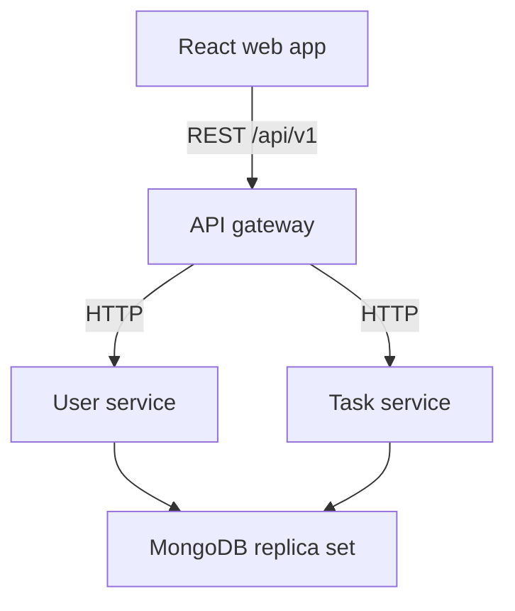

# Task Management

Task Management is a workspace-based application for organizing projects and tracking tasks. The React web app provides board and list views, and a Go API gateway exposes a versioned REST API backed by separate user and task services.

## Features

- **Workspaces and projects** — Create workspaces, organize work into projects, invite members, and manage access through owner, admin, member, and viewer roles.
- **Task management** — Create, assign, filter, reorder, archive, and restore tasks. Track status, priority, dates, labels, checklists, and dependencies.
- **Account management** — Register, sign in, rotate refresh sessions, verify email addresses, and reset passwords.
- **Reliable updates** — The task service supports idempotency keys for documented mutations, version checks for concurrent edits, and activity and audit records.

## Architecture



| Directory | Responsibility |
| --- | --- |
| [`webapp/`](webapp/) | React, TypeScript, and Vite frontend with React Router and TanStack Query |
| [`gateway-service/`](gateway-service/) | Go and Fiber gateway for browser requests, access-token validation, rate limiting, and the OpenAPI contract |
| [`user-service/`](user-service/) | Go service for accounts, authentication, and session management over HTTP and gRPC |
| [`task-service/`](task-service/) | Go service for workspaces, projects, membership, tasks, and audit history over HTTP and gRPC |

The gateway forwards requests to the services over HTTP. The user and task services also expose their own gRPC interfaces. The root Compose stack runs a single-node MongoDB replica set so the task service can write task state, activity, and idempotency records in a transaction.

## Getting started

### Prerequisites

- Docker with the Compose plugin
- Node.js 22 and npm for the web app
- Go matching each service's `go.mod` and Make for running backend checks locally

### Start the backend

```sh
git clone https://github.com/Ishan-Gijavanekar/Task-Management.git
cd Task-Management
docker compose up -d --build
```

### Start the web app

From the repository root, run:

```sh
cd webapp
npm ci
npm run dev
```

Open [http://localhost:5173](http://localhost:5173). Create an account, then create a workspace and a project to start adding tasks. To reopen an existing workspace, use its workspace ID. The web app remembers workspaces you create or open in that browser.

| Local endpoint | Purpose |
| --- | --- |
| [`http://localhost:5173`](http://localhost:5173) | Web app |
| `http://localhost:8088/api/v1` | Public REST API base URL |
| [`http://localhost:8088/openapi.json`](http://localhost:8088/openapi.json) | OpenAPI 3.1 contract |
| [`http://localhost:8088/livez`](http://localhost:8088/livez) and [`http://localhost:8088/readyz`](http://localhost:8088/readyz) | Gateway liveness and upstream readiness |
| [`http://localhost:8088/metrics`](http://localhost:8088/metrics) | Gateway metrics in Prometheus format |

The root Compose stack publishes only the gateway to the host. The Vite dev server proxies `/api` to the gateway. To stop the backend, run `docker compose down` from the repository root. MongoDB data persists in the `mongo_data` volume.

## Configuration

The root Compose file includes development defaults. For standalone services, use the relevant example as a starting point.

| Component | Settings |
| --- | --- |
| [Gateway](gateway-service/.env.example) | `PUBLIC_ORIGIN`, upstream service URLs, JWT settings, and HTTP limits |
| [User service](user-service/.env.example) | MongoDB connection, JWT signing settings, refresh cookies, verification, and SMTP |
| [Task service](task-service/.env.example) | MongoDB replica-set connection, JWT verification settings, and service timeouts |
| [Web app](webapp/README.md) | `VITE_API_URL` for a different API origin. Include the `/api/v1` suffix. |

For deployments outside local development, supply a strong JWT signing secret, align the JWT settings across the services, set the gateway's allowed browser origin, and enable secure refresh cookies over HTTPS. Configure SMTP for email verification and password reset delivery.

## API contracts

The public API contract lives in [`gateway-service/api/openapi.json`](gateway-service/api/openapi.json). Protected requests use a bearer access token. Browser sessions refresh through an HttpOnly cookie. See the [public API policy](gateway-service/docs/api-policy.md) for error responses, pagination, idempotency, and compatibility rules. Workspace permissions are documented in the [authorization matrix](task-service/docs/authorization.md).

After changing the OpenAPI contract, run these commands from `gateway-service/`:

```sh
make generate
make contract
make types-check
```

## Testing and CI

Run the backend checks from the relevant service directory. Each service is a separate Go module.

```sh
go vet ./...
go test -race ./...
```

The user service also provides `make coverage-check` and `make test-integration`. Set `MONGO_INTEGRATION_URI` to a reachable MongoDB instance for the integration tests.

Run the frontend checks from `webapp/` after `npm ci`:

```sh
npm run format:check
npm run lint
npm test
npm run build
npx playwright install chromium
npm run test:e2e
```

The [GitHub Actions workflow](.github/workflows/ci.yml) runs these checks on pushes and pull requests. It also checks OpenAPI compatibility and generated types, scans the user service with `govulncheck`, scans Git history with Gitleaks, and scans the three backend images with Trivy.

## Further documentation

- [Web app development and testing](webapp/README.md)
- [API gateway and contract workflow](gateway-service/README.md)
- [User service and authentication lifecycle](user-service/README.md)
- [Task service and workspace operations](task-service/README.md)
