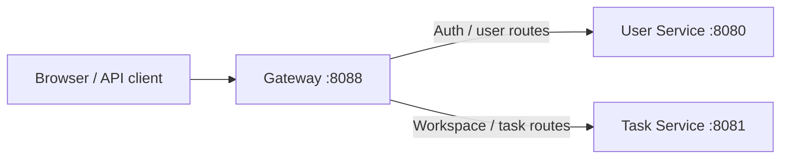

# API Gateway Service

The API Gateway is the single public HTTP entry point for the Task Management backend. Written in Go with Fiber, it exposes the versioned `/api/v1` REST API, validates bearer tokens on protected routes, applies HTTP policy, and forwards requests to the user and task services.

## Responsibilities

- Route requests to the correct internal service using an explicit route table.
- Authenticate protected routes using the shared JWT signing/verification configuration.
- Enforce endpoint-specific rate limits and inbound/outbound request limits.
- Handle browser CORS with one configured `PUBLIC_ORIGIN` and forward refresh cookies.
- Apply bounded upstream timeouts and preserve request/trace context.
- Publish the canonical OpenAPI contract and derived frontend type definitions.
- Expose health, readiness and Prometheus-format metrics endpoints.

The gateway is not responsible for workspace authorization or task business rules; those remain in the domain services. It communicates with upstream services over **HTTP**, while those services separately expose gRPC APIs.

## Request flow



## Directory guide

```text
gateway-service/
├── api/                       # OpenAPI contract, baseline, generated TS types
├── cmd/server/                # Gateway entry point
├── cmd/contract-check/        # Backward compatibility checker
├── cmd/openapi-types/         # TypeScript contract type generator
├── docs/api-policy.md         # Public API conventions
├── internal/auth/             # JWT validation
├── internal/config/           # Configuration and validation
├── internal/contract/         # API compatibility rules
├── internal/gateway/          # Routing, proxying, route controls
├── internal/observability/    # Distributed tracing
├── internal/ratelimit/        # Request rate limiting
├── internal/transport/http/   # Fiber server and middleware
├── .env.example
├── Dockerfile
├── Makefile
└── go.mod
```

## Getting started

**Recommended:** from the repository root, run:

```bash
docker compose up -d --build
```

The gateway is then reachable at `http://localhost:8088`; both upstream services and MongoDB run on the same internal Compose network.

For standalone local development, ensure the upstream user and task services are running and accessible, then:

```bash
cd gateway-service
cp .env.example .env
# Configure PUBLIC_ORIGIN, upstream URLs and JWT settings
go mod download
go run ./cmd/server
```

The gateway environment example uses `localhost:8080` and `localhost:8081`, which are appropriate only when the corresponding services are separately exposed on those host ports. In the root Compose stack the upstream addresses are `http://user-service:8080` and `http://task-service:8081`.

## Environment configuration

| Variable | Example | Description |
| --- | --- | --- |
| `HTTP_PORT` | `8088` | Public HTTP listen port |
| `PUBLIC_ORIGIN` | `http://localhost:5173` | Single browser origin allowed for credentialed CORS |
| `USER_SERVICE_URL` | `http://localhost:8080` | Internal user HTTP endpoint |
| `TASK_SERVICE_URL` | `http://localhost:8081` | Internal task HTTP endpoint |
| `JWT_SECRET` | `replace-me` | Secret shared with token issuer for configured signing mode |
| `JWT_ACTIVE_KEY_ID` | `current` | JWT key identifier |
| `JWT_ISSUER` | `user-service` | Accepted token issuer |
| `HTTP_BODY_LIMIT_MB` | `2` | Incoming body limit |
| `HTTP_RESPONSE_LIMIT_MB` | `8` | Proxied response limit |
| `UPSTREAM_TIMEOUT` | `5s` | Upstream HTTP timeout |
| `SHUTDOWN_TIMEOUT` | `10s` | Graceful shutdown allowance |
| `HTTP_TRUSTED_PROXIES` | empty | Explicit trusted proxy configuration |
| `OTEL_EXPORTER_OTLP_ENDPOINT` | `http://localhost:4317` | Optional OTLP/gRPC trace exporter endpoint |

See [`.env.example`](.env.example) for supported key rotation configuration (`JWT_KEYS`). Do not commit actual secrets. `PUBLIC_ORIGIN` must be one explicit absolute origin, not a wildcard or comma-separated list.

## HTTP operations

| Method | Endpoint | Purpose |
| --- | --- | --- |
| `GET` | `/livez` | Process liveness |
| `GET` | `/readyz` | Bounded checks of both upstream services |
| `GET` | `/metrics` | Prometheus-format request metrics |
| `GET` | `/openapi.json` | Embedded OpenAPI contract |

Public application routes use `/api/v1` and include `auth`, `users`, `me`, `workspaces`, `projects`, `tasks`, `invitations`, and `notifications` route families. Refer to [`api/openapi.json`](api/openapi.json) for exact request/response schemas and available methods.

Requests include `X-Request-ID` on responses. W3C `traceparent`, `tracestate`, and `baggage` headers are continued and propagated to upstream services.

## OpenAPI workflow

The authoritative public specification is [`api/openapi.json`](api/openapi.json). Generated TypeScript models are checked into [`api/generated.ts`](api/generated.ts). From this directory:

```bash
make generate      # Regenerate TypeScript types
make contract      # Check compatibility against committed baseline
make types-check   # Fail when committed generated types are stale
```

The compatibility checker protects established operations, required response fields and existing enum values. Update [`api/compatibility-baseline.json`](api/compatibility-baseline.json) only when an intentional breaking API release has been reviewed. See [`docs/api-policy.md`](docs/api-policy.md) for pagination, idempotency, retries, error responses and deprecation guidance.

## Quality checks

```bash
make vet
make test
go test -race ./...
make build
```

The repository-wide CI workflow also verifies formatting, contract compatibility, generated types, image builds and vulnerability scanning.

## Production notes

Place the gateway behind HTTPS, configure the exact allowed frontend origin, rotate/secure signing keys, and supply internal service URLs. Set proxy trust only for known proxies and configure telemetry if distributed tracing is required. A healthy gateway process does not imply that the upstream services are ready; use `/readyz` for dependency checks.

## Related documentation

- [Platform overview](../README.md)
- [API policy](docs/api-policy.md)
- [User service](../user-service/README.md)
- [Task service](../task-service/README.md)
