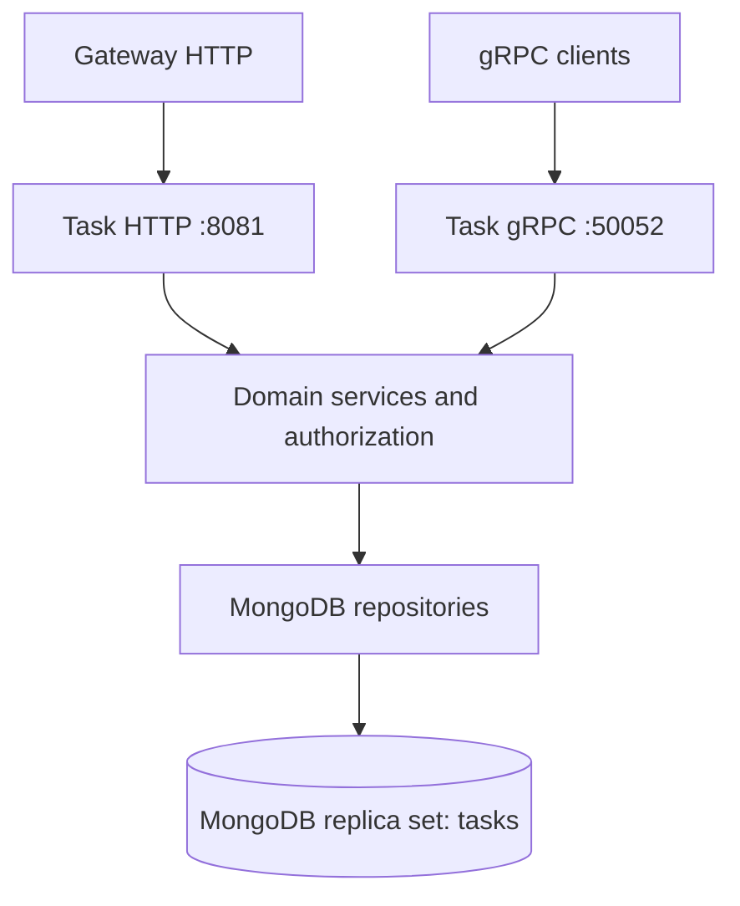

# Task Service

The Task Service provides the workspace, project, collaboration and task-management domain for the Task Management platform. Built in Go with Fiber, gRPC and MongoDB, it owns authorization for workspace resources and records changes with consistency and auditability safeguards.

## Capabilities

- **Workspace administration:** Creation, settings, archival and ownership transfer.
- **Membership and invitations:** Owner, admin, member and viewer roles; member updates; revocation; invitations with expiration and hashed tokens.
- **Projects:** Workspace-scoped projects with visibility rules and configurable workflow statuses.
- **Tasks:** Create, read, update, archive, restore, reorder, and batch-update tasks.
- **Task metadata:** Priority, assignee, reporter, labels, dates, estimates, checklists and dependencies.
- **Collaboration:** Comments, activity history, administrative audit events and notifications.
- **Consistency:** Opaque cursor pagination, entity versions, idempotency keys and transactional writes.
- **Operations:** Readiness and liveness endpoints, metrics, and optional tracing.

## Architecture



The service owns its persistence and internal authorization. Its gRPC contracts are versioned as `task.v1.TaskService` and `task.v1.WorkspaceService`; browser calls are routed through the gateway over HTTP.

## Start locally

The simplest integrated startup is from the repository root:

```bash
docker compose up -d --build
```

The root stack configures MongoDB 7.0 as a single-node replica set, supplies the `tasks` database, and starts the Task Service internally on ports `8081` (HTTP) and `50052` (gRPC). Transactional task operations require MongoDB replica-set support.

For task-service-only development, a dedicated compose file is available:

```bash
cd task-service
docker compose up --build
```

Alternatively, configure `.env` against a reachable replica set and run:

```bash
cd task-service
cp .env.example .env
go mod download
go run ./cmd/server
```

**Important:** The standalone `.env.example` illustrates `mongodb://localhost:27018/?replicaSet=rs0`; the root Compose stack uses the hostname `mongo` inside Docker and exposes MongoDB on host port `27019`. Use the correct URI for the chosen setup.

## Configuration

| Variable | Description |
| --- | --- |
| `HTTP_PORT` | HTTP listen port (`8081` in sample) |
| `GRPC_PORT` | gRPC listen port (`50052` in sample) |
| `MONGO_URI`, `MONGO_DATABASE` | MongoDB replica-set connection and task database |
| `JWT_SECRET`, `JWT_ACTIVE_KEY_ID`, `JWT_ISSUER` | Access token validation configuration |
| `JWT_KEYS` | Optional signing-key rotation mapping |
| `SHUTDOWN_TIMEOUT`, `DEPENDENCY_TIMEOUT` | Bounded shutdown and dependency checks |
| `SERVICE_CONCURRENCY_LIMIT` | Concurrent service operation limit |
| `OTEL_EXPORTER_OTLP_ENDPOINT` | Optional OTLP/gRPC tracing endpoint |

See [`.env.example`](.env.example) for examples. JWT issuer/key settings must match the User Service and Gateway.

## Authorization model

Workspace roles include `owner`, `admin`, `member` and `viewer`. Owners and admins can manage projects and invitations, while only owners can archive a workspace or transfer ownership. Private projects and their tasks are restricted to owners and admins. Removed members lose access; historical task attribution and relevant audit records are retained. For the precise permission matrix, see [`docs/authorization.md`](docs/authorization.md).

Invitation tokens are generated for invite/resend flows but stored in MongoDB as SHA-256 hashes. Invitations are single-use, expiring and revocable. The documented default expiry is seven days. Invitation creation/resends are rate-limited.

## REST API surface

Examples below use the public `/api/v1` prefix; replace `{workspaceId}`, `{projectId}` and `{taskId}` with actual resource IDs.

| Method | Route | Purpose |
| --- | --- | --- |
| `POST` | `/workspaces` | Create workspace |
| `GET / PATCH / DELETE` | `/workspaces/{workspaceId}` | Read, edit or archive workspace |
| `POST` | `/workspaces/{workspaceId}/transfer` | Transfer ownership |
| `GET / POST` | `/workspaces/{workspaceId}/projects` | List or create projects |
| `GET / PATCH / DELETE` | `/workspaces/{workspaceId}/projects/{projectId}` | Project operations |
| `GET` | `/workspaces/{workspaceId}/members` | List members |
| `PATCH / DELETE` | `/workspaces/{workspaceId}/members/{userId}` | Update/remove member |
| `POST` | `/workspaces/{workspaceId}/invitations` | Invite a user |
| `GET / POST` | `/workspaces/{workspaceId}/tasks` | List/create tasks |
| `GET / PATCH / DELETE` | `/workspaces/{workspaceId}/tasks/{taskId}` | Task operations |
| `POST` | `/workspaces/{workspaceId}/tasks/{taskId}/restore` | Restore archived task |
| `POST` | `/workspaces/{workspaceId}/tasks/{taskId}/reorder` | Reorder task |
| `PATCH` | `/workspaces/{workspaceId}/tasks:batch` | Batch task changes |
| `GET / POST` | `/workspaces/{workspaceId}/tasks/{taskId}/comments` | List/create comments |
| `GET` | `/workspaces/{workspaceId}/audit-events` | Workspace audit history |

The gateway also routes labels, activities, notification and preference operations. For authoritative schemas, method support and errors, use [`gateway-service/api/openapi.json`](../gateway-service/api/openapi.json).

## gRPC contracts

The protobuf definitions are located at:

- [`api/proto/task/v1/task.proto`](api/proto/task/v1/task.proto) — task CRUD, list, restore, reorder and batch update.
- [`api/proto/task/v1/administration.proto`](api/proto/task/v1/administration.proto) — workspace, project, invitation, membership and audit operations.

To regenerate the checked-in Go protobuf bindings, install `protoc`, `protoc-gen-go` and `protoc-gen-go-grpc`, then run `make generate` from this directory.

## Concurrency, transactions and pagination

List endpoints use opaque cursors with stable ordering. Documented mutations accept `Idempotency-Key` to prevent duplicate effects from retries. Updates, archival, restoration, reordering and batches also require the latest resource `version`; stale versions fail with HTTP `409` or gRPC `ABORTED`. MongoDB transactions group task mutations, activity writes and idempotency outcomes for data integrity.

The service creates indexes during startup. For production operation, the project recommends provisioning the committed indexes ahead of switching traffic. When upgrading an existing deployment with older memberships, consult the existing Phase 11 migration notes in the repository history/documentation: membership records may require `status`, `createdAt` and `updatedAt` backfills.

## Operations and tests

| Method | Endpoint | Purpose |
| --- | --- | --- |
| `GET` | `/livez` | Process liveness |
| `GET` | `/readyz` | MongoDB readiness |
| `GET` | `/metrics` | Prometheus-format metrics |

Run these from the service directory:

```bash
make vet
make test
# Or run directly:
go vet ./...
go test -race ./...
```

The CI pipeline checks formatting, tests, container builds and Trivy image vulnerabilities.

## Related documentation

- [Platform overview](../README.md)
- [Workspace authorization](docs/authorization.md)
- [User service](../user-service/README.md)
- [Gateway service](../gateway-service/README.md)
