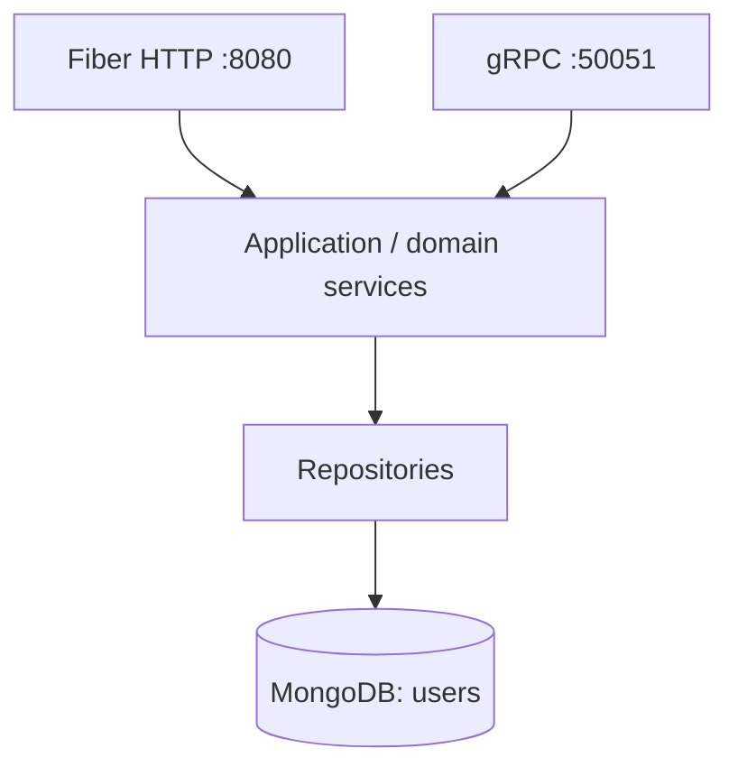

# User Service

The User Service manages user identities, account lifecycle and authentication for Task Management. It is implemented in Go, exposes Fiber HTTP endpoints and a Protocol Buffers-based gRPC interface, and persists users and session data in MongoDB.

## Capabilities

- User registration, login, profile retrieval and user management.
- JWT access tokens with issuer and signing-key configuration.
- Refresh sessions using rotating tokens delivered through an `HttpOnly` browser cookie.
- Detection of reused rotated refresh tokens and revocation of the affected token family.
- Email verification and resend-verification flows.
- Forgot-password and reset-password workflows.
- Optional requirement for email verification before login.
- HTTP liveness, MongoDB readiness checks and automated repository/service tests.

The API Gateway validates protected public requests before forwarding them. The User Service remains the authority for user and authentication records; other services use the verified identity when applying their own domain permissions.

## Architecture



Primary directories include `cmd/server` (application startup), `api` (protocol definitions), `internal/config`, `internal/database`, `internal/domain`, `internal/repository`, `internal/service`, and `internal/transport` (HTTP and gRPC). The `tests` directory contains additional test coverage.

## Run the service

For the complete platform, from the repository root:

```bash
docker compose up -d --build
```

The root Compose configuration starts this service internally on HTTP `8080` and gRPC `50051`, using the `users` MongoDB database. Neither application port is published to the host by that stack.

For standalone development, start MongoDB and configure the service to reach it:

```bash
cd user-service
cp .env.example .env
# Edit .env with reachable MongoDB and JWT settings
go mod download
go run ./cmd/server
```

The sample `.env.example` uses a local authenticated MongoDB URI and database `user_service`, while the root Compose stack uses the internal `mongo` host and database `users`. Choose settings matching the environment in which the service runs rather than mixing both configurations.

## Configuration

| Variable | Purpose |
| --- | --- |
| `APP_NAME`, `APP_ENV` | Application name and runtime environment |
| `HTTP_PORT`, `GRPC_PORT` | HTTP and gRPC listener ports (defaults in sample: `8080`, `50051`) |
| `MONGO_URI`, `MONGO_DATABASE` | MongoDB connection and database |
| `JWT_SECRET`, `JWT_ACTIVE_KEY_ID`, `JWT_PREVIOUS_KEYS`, `JWT_ISSUER` | Token signing, issuer and rotation configuration |
| `JWT_ACCESS_TOKEN_DURATION` | Access-token lifespan (sample: `15m`) |
| `AUTH_REFRESH_TOKEN_DURATION` | Refresh-session lifespan (sample: `720h`) |
| `AUTH_REFRESH_COOKIE_NAME`, `AUTH_REFRESH_COOKIE_SECURE` | Browser session cookie behavior |
| `AUTH_REQUIRE_EMAIL_VERIFICATION` | Require verified email before login when enabled |
| `AUTH_FRONTEND_URL` | Origin for verification/recovery links |
| `SMTP_HOST`, `SMTP_PORT`, `SMTP_USERNAME`, `SMTP_PASSWORD`, `SMTP_FROM` | Outgoing mail transport |
| `HTTP_ALLOWED_ORIGINS`, `HTTP_BODY_LIMIT_MB`, `HTTP_TRUSTED_PROXIES` | HTTP origin and proxy controls |

See [`.env.example`](.env.example) for the complete sample. The development Compose configuration sets `AUTH_REFRESH_COOKIE_SECURE=false` to support local HTTP. In production, use HTTPS with secure cookies and configure SMTP for external email delivery.

## REST API

All examples below are prefixed by `/api/v1` when accessed through the gateway.

| Method | Path | Purpose |
| --- | --- | --- |
| `POST` | `/auth/register` | Create an account |
| `POST` | `/auth/login` | Authenticate and establish a session |
| `POST` | `/auth/refresh` | Rotate a refresh session and issue an access token |
| `POST` | `/auth/logout` | End a refresh session |
| `POST` | `/auth/forgot-password` | Begin account recovery |
| `POST` | `/auth/reset-password` | Complete password reset |
| `POST` | `/auth/verify-email` | Confirm email ownership |
| `POST` | `/auth/resend-verification` | Request another verification message |
| `GET` | `/me` | Get the current authenticated user |
| `GET` | `/users` | List users (authenticated) |
| `GET / PUT / DELETE` | `/users/{id}` | User record operations |

For exact payloads, authorization requirements, response schemas and error codes, refer to the [gateway OpenAPI document](../gateway-service/api/openapi.json).

### Authentication design

Short-lived access tokens are paired with refresh sessions. Refresh tokens are stored as SHA-256 hashes instead of plaintext, and browser sessions are sent in `HttpOnly` cookies. Reuse of an already rotated refresh token causes revocation of its token family. Development verification and reset links may appear in structured logs; non-development environments should use SMTP.

## Health and diagnostics

| Method | Path | Meaning |
| --- | --- | --- |
| `GET` | `/health/live` | Process liveness |
| `GET` | `/health/ready` | Bounded MongoDB readiness |
| `GET` | `/health` | Compatibility health endpoint |

## Tests and quality

Run from `user-service/`:

```bash
make quality         # Formatting, vet and tests
make test-race       # Go race detector
make test-cover      # Coverage report
make coverage-check  # Enforce documented coverage minimum
```

To run optional repository integration tests against a reachable MongoDB instance:

```bash
MONGO_INTEGRATION_URI='mongodb://localhost:27017' make test-integration
```

Adjust the URI for authenticated or non-default MongoDB deployments. CI runs the integration suite using a dedicated MongoDB service, along with `govulncheck`, image vulnerability scanning and other platform checks.

## Security and deployment considerations

Replace development JWT secrets, align the issuer and verification settings with the gateway and task service, enforce TLS and secure cookies, and keep signing credentials and SMTP secrets outside source control. When deploying independently, ensure the selected MongoDB URI is reachable from the service process or container.

## Related documentation

- [Platform overview](../README.md)
- [Gateway service](../gateway-service/README.md)
- [Task service](../task-service/README.md)
